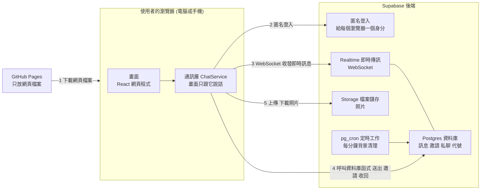
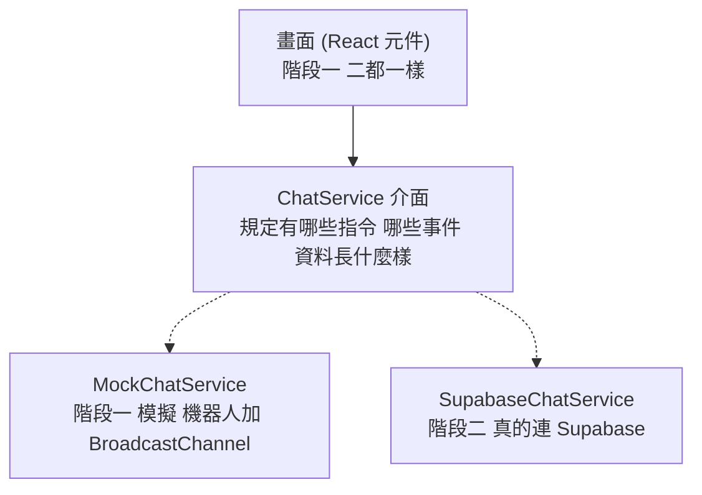
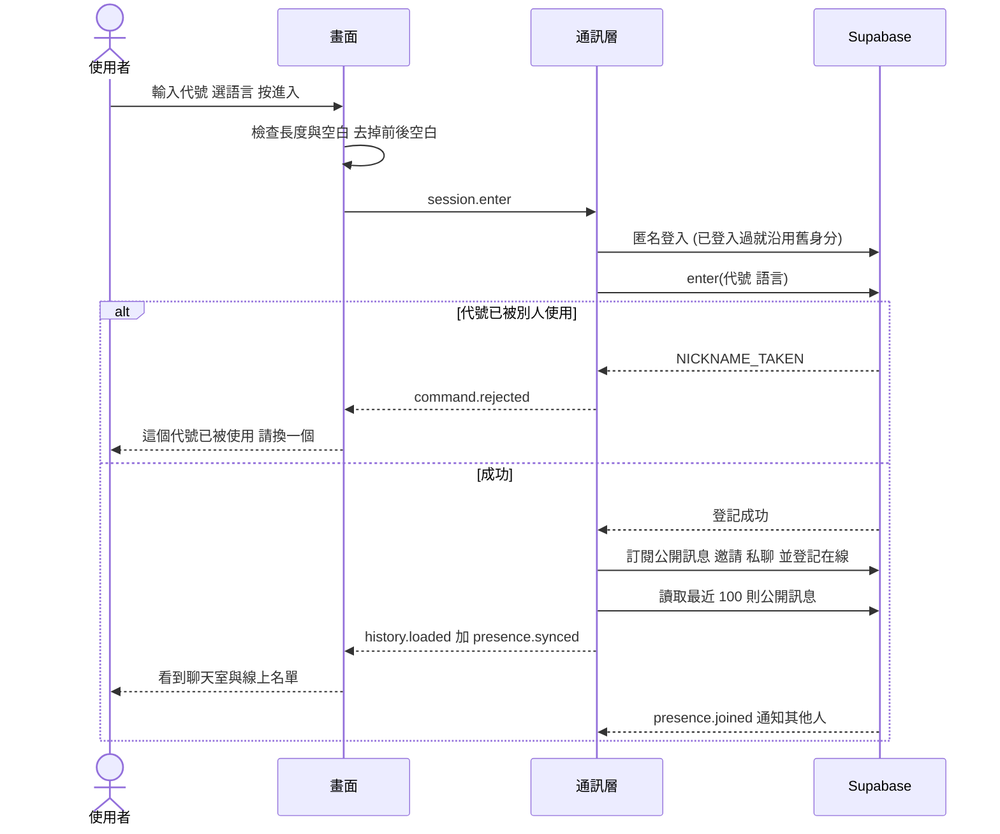
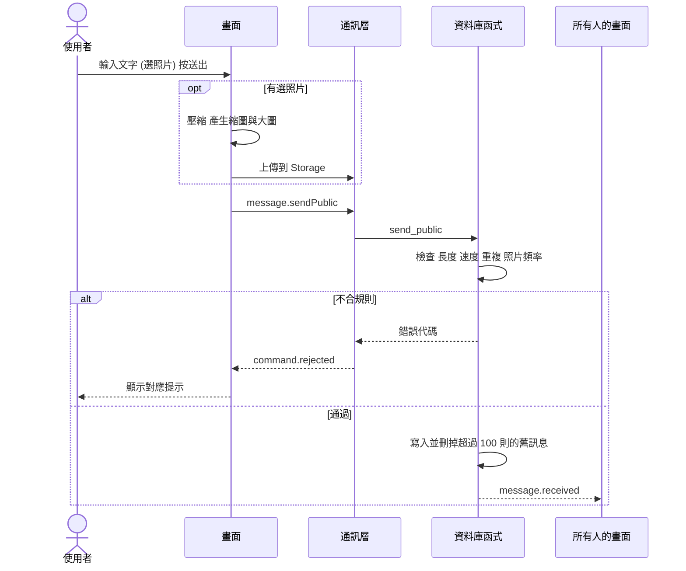
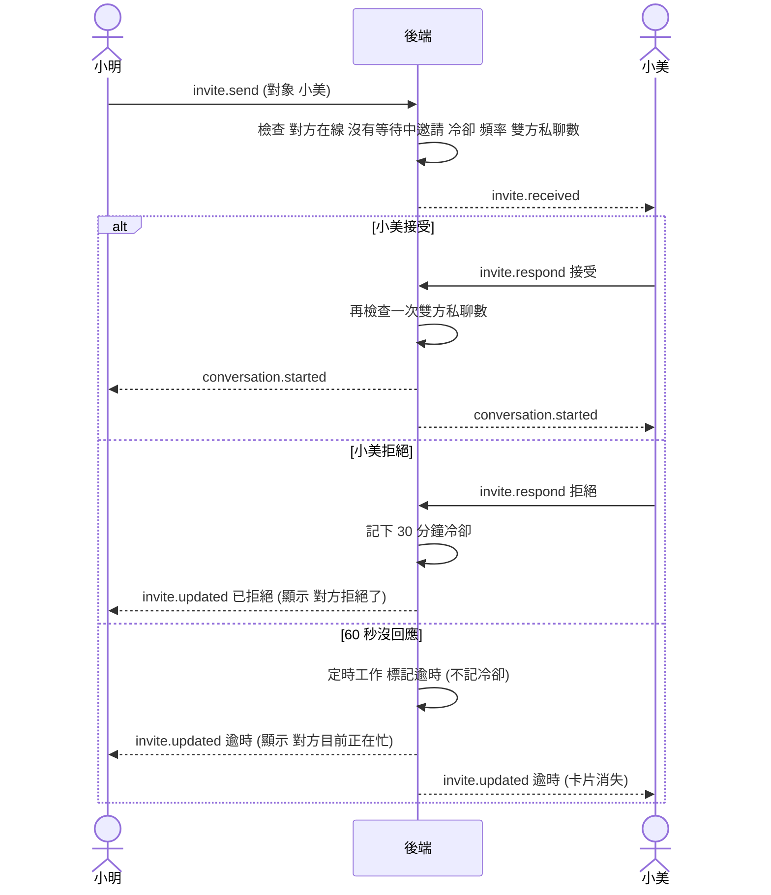
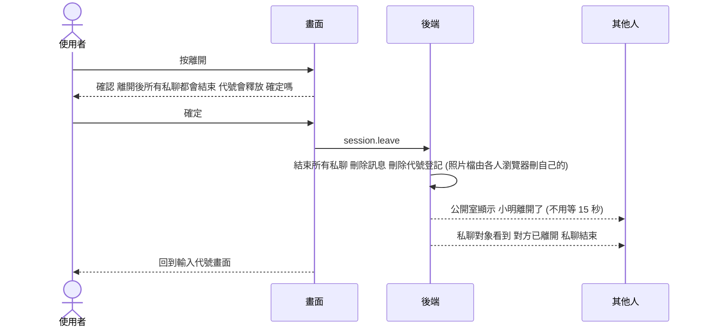
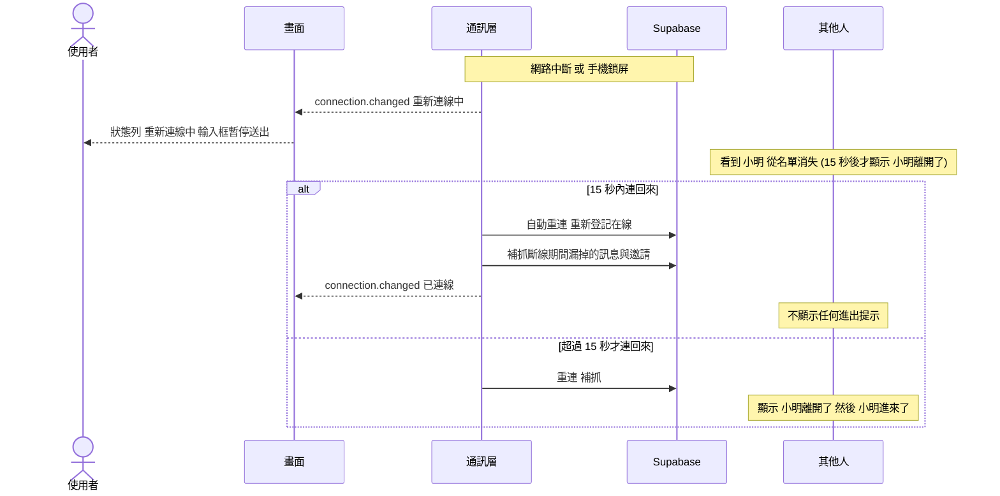

# 匿名聊天室:架構文件

版本日期:2026-10-13
對應的需求文件:`docs/requirements.md`

> 這份文件寫給「不寫程式的人」看。專有名詞第一次出現時,會用一句話解釋。
> 標示「**我的決定**」的地方,是需求沒有說、由我替你決定的,你可以要求改。

---

## 1. 專案說明與目標

### 這是什麼
一個不用登入的匿名聊天室。任何知道網址的人,輸入一個代號(暱稱)就能進來。
所有人在同一個公開聊天室裡聊天,也可以邀請某個人私聊,對方按「接受」才會開始。
聊天內容可以傳文字和照片,介面有六種語言:繁體中文、English、日本語、한국어、Español、Français。
手機和電腦都能用。

### 目標
1. **先做出看得到的網頁**:階段一只做前端,放到 GitHub Pages(GitHub 提供的免費網頁空間,把網頁檔案放上去,別人用網址就能打開)。
2. **再接上即時傳訊**:階段二才接 Supabase(一個現成的後端服務,提供資料庫、檔案儲存和即時傳訊,不用自己架伺服器)。
3. **兩個階段之間不重寫**:畫面程式在階段一寫好之後,階段二只替換「負責傳訊的那一層」。

### 已確定的產品規則(來自我們的問答)
| 項目 | 規則 |
|---|---|
| 代號 | 1~20 字,任何文字都可以,前後空白自動去掉,不能全是空白。**代號重複就不能進入**。不擋髒話 |
| 公開聊天 | 新人進來看得到最近 100 則;文字上限 500 字;電腦和手機都一直顯示字數(如 `23/500`) |
| 進出提示 | 斷線後等 15 秒才宣布「離開」,15 秒內回來就不顯示任何提示 |
| 私聊邀請 | 對方按接受才開始;按「拒絕」後,30 分鐘內同一個人不能再邀請同一個對象 |
| 邀請沒回應 | 60 秒沒回應就自動拒絕,邀請者看到「對方目前正在忙」;**這不算被拒絕**,可以馬上再邀請 |
| 私聊數量 | 一個人同時最多 5 個私聊 |
| 重新整理 | 私聊**不會**因為重新整理而結束,只有按「結束私聊」才結束;重新整理後訊息和照片還在 |
| 對方離線 | 私聊中對方離線超過 30 分鐘,私聊自動結束;這段期間他的代號保留 |
| 離開 | 按「離開」會結束**所有**私聊、釋放代號,按之前先確認 |
| 照片 | JPG、PNG、WebP;上限 2 MB;送出前在瀏覽器壓縮;先預覽再送出;一次一張,可附文字 |
| 收回 | 只能收回自己的訊息或照片,內容真的刪除,畫面留下灰色「此訊息已收回」 |
| 防洗版 | 每秒最多 3 則;同樣內容 1 分鐘內最多 3 次;同一個人對同一個對象 1 分鐘最多邀請 2 次;照片每分鐘最多 3 張 |
| 語言 | 預設依瀏覽器語言;系統訊息用每個人自己選的語言顯示,中途切換語言,舊的系統訊息也跟著變;聊天內容不翻譯 |
| 外觀 | 淺色系(薰衣草紫、淺粉紅、水藍色)黑字;深色模式是同色系的暗色版、白字;預設跟隨系統,可手動切換並記住 |
| 時間 | 每則訊息顯示時間(用使用者自己的時區),跨日有日期分隔線,不做「已讀」 |

---

## 2. 整體架構圖

先認識圖裡會出現的幾個詞:

- **瀏覽器**:使用者打開網頁用的軟體(Chrome、Safari 等),我們寫的網頁程式在這裡執行。
- **GitHub Pages**:只負責「把網頁檔案交給瀏覽器」。它不會處理聊天,也不會記任何資料。
- **Supabase**:負責聊天的後端(躲在背後、幫忙處理資料的那一端)。
- **WebSocket**:瀏覽器和伺服器之間一條「一直保持連著」的線,伺服器有新訊息可以馬上推過來,不用瀏覽器一直問「有新訊息嗎」。
- **Postgres**:Supabase 裡的資料庫(一個存放表格資料的地方)。
- **Storage**:Supabase 裡存放檔案(我們這裡是照片)的地方。
- **Edge Function**:放在 Supabase 上、可以被定時叫起來執行的一小段程式。**第一版沒有用到**(原本打算用它清掃沒人引用的照片檔,見 9.2),之後需要再補。



**怎麼讀這張圖**
- 第 1 步:使用者打開網址,GitHub Pages 把網頁檔案交給瀏覽器,之後 GitHub 就不再參與。
- 第 2~5 步:網頁裝在使用者的瀏覽器裡,直接和 Supabase 溝通。**沒有我們自己架的伺服器**。
- 「通訊層 ChatService」是整份設計的關鍵:畫面不直接碰 Supabase,所有傳訊都經過它。階段一它是假的(模擬),階段二換成真的,見第 4 節。

---

## 3. 技術選擇

每一項都寫「選了什麼」和「為什麼」。

### 3.1 前端

| 項目 | 選了什麼 | 為什麼 |
|---|---|---|
| 語言 | **TypeScript**(JavaScript 加上「資料型別檢查」) | 瀏覽器只懂 JavaScript。TypeScript 會在寫程式時就檢查資料格式對不對(例如「訊息一定有 id 和時間」),階段二換成真的後端時,格式對不上會馬上被抓到,不會等到使用者遇到才發現 |
| 框架 | **React** | 聊天室是「資料一變、畫面就跟著變」的典型情況(新訊息、上線名單、未讀數)。React 就是為這個設計的,而且資料最多、遇到問題最容易找到解答 |
| 打包工具 | **Vite**(把我們寫的很多檔案整理成瀏覽器能讀的幾個檔案) | 啟動快、設定少,對 GitHub Pages 這種「靜態網站」支援好 |
| 多語言 | **react-i18next**(管理多國語言文字的套件) | 六種語言各一個文字檔,畫面上只寫「文字代號」,不寫死中文。切換語言時整個畫面立刻換 |
| 畫面狀態 | **Zustand**(一個小型的「全部畫面共用資料」管理套件) | 聊天室有很多地方要共用同一份資料(線上名單、未讀數、目前選到哪個對話)。它比自己傳來傳去簡單 |
| 樣式 | **CSS 變數**(把顏色集中定義成一組「名字 → 顏色」) | 淺色和深色模式只是換一組顏色,畫面本身不用改。這也讓 /design 的成果可以直接套進來 |
| 圖片壓縮 | **browser-image-compression** | 在瀏覽器裡把照片縮小再上傳,見 3.3 |
| 測試 | **Vitest**(測小邏輯與規則)、**PGlite**(在記憶體裡跑真的 Postgres,測資料庫規則)、**Playwright**(用機器人真的操作網頁,連真實 Supabase) | 見第 13 節 |

**我的決定**:不使用網址路由(例如 `/room/123`)。整個網站只有一個網址,畫面切換靠程式內部狀態。原因:GitHub Pages 不認得「自訂路徑」,使用者在 `/room/123` 重新整理會看到「找不到頁面」。

### 3.2 Supabase 用哪些功能

| 需求 | 用哪個功能 | 為什麼 |
|---|---|---|
| 「不用登入」,但伺服器仍要分得出誰是誰 | **Anonymous Sign-in(匿名登入)**:瀏覽器第一次進來時,Supabase 自動發一張「身分證」(一個長長的編號加簽章,稱為 JWT),使用者完全不用輸入任何東西 | 沒有身分證,就沒辦法做到「私聊只有兩個人看得到」。有了它,資料庫能知道「現在是誰在讀這筆資料」。身分證存在瀏覽器裡,重新整理後還是同一個人,所以私聊才能撐過重新整理 |
| 誰在線上 | **Realtime Presence**(即時「在線狀態」功能) | 每個人上線時登記一筆,斷線時自動消失,所有人都會即時收到變動 |
| 新訊息、新邀請即時送達 | **Realtime Postgres Changes**(資料庫一有新增,就透過 WebSocket 推給有權看的人) | 訊息先寫進資料庫,再由資料庫推給大家。好處是:重新整理後訊息還在(從資料庫讀回來),而且推送時會**自動遵守下面的存取規則** |
| 「私聊只有兩個人看得到」 | **Row Level Security(RLS,列級安全規則)** | 這是在資料庫裡寫的規則,例如「只有這個私聊的兩位參與者,才能讀這個私聊的訊息」。就算有人繞過我們的網頁、直接去敲 Supabase 的網址,也讀不到。**這是真正的安全,前端的檢查只是方便使用者** |
| 送訊息、邀請、收回時的各種檢查 | **Database Function(資料庫函式,透過 RPC 呼叫)**。RPC 就是「瀏覽器請資料庫執行一個事先寫好的動作」 | 送出訊息要檢查「每秒 3 則」「重複內容」「長度」「有沒有被拒絕過」。這些檢查如果放在前端,有心人跳過網頁就能繞過;放在資料庫函式裡,就沒辦法跳過 |
| 照片 | **Storage**,分兩個「桶子」(bucket):公開聊天的照片桶、私聊的照片桶 | 私聊桶設為「私有」,要有權限才能看(見 9.2),這樣私聊照片才不會被別人用網址猜到 |
| 定時清理 | **pg_cron**(資料庫內建的定時器) | 邀請逾時、私聊自動結束、代號釋放、清掉過期紀錄,都要有人「定時巡邏」。這件事不能交給使用者的瀏覽器,因為使用者可能已經關掉網頁。(清掃沒人引用的照片檔需要 Edge Function,第一版不做,見 9.2) |

**為什麼不自己架伺服器?** 你的需求是 GitHub Pages 加 Supabase,而且你不寫程式。自己架伺服器要處理主機、更新、安全修補,成本遠超過這個專案的需要。

### 3.3 照片的處理方式(**我的決定**)
- 使用者選一張照片後,瀏覽器**產生兩個版本**:
  - **縮圖**:最長邊約 320 像素,壓到 50 KB 以下(多半約 20 KB),用在對話裡顯示。
  - **大圖**:最長邊最多 1600 像素,壓縮到 2 MB 以下,點開放大時才讀取。
- 為什麼要兩個版本?新人進公開聊天室會一次載入最近 100 則訊息。如果每張都載大圖,免費方案的流量(見 9.3)會很快用完。
- 照片經過瀏覽器重新繪製、重新存檔,所以:
  - 照片裡的 **GPS 位置、手機型號等隱藏資料(EXIF)會被清掉**,保護使用者隱私。
  - 偽裝成圖片的其他檔案會在這一步被擋下。

---

## 4. 兩個階段

### 4.1 階段一:先不接 Supabase

**目標**:所有畫面和操作都做好,放上 GitHub Pages 就能看到、能點、能試。

**前端要做到什麼程度**
- 第 7 節列的所有畫面和互動全部完成,包含六種語言、淺色與深色、手機與電腦排版。
- 後面接的是一個**模擬的通訊層(`MockChatService`)**,它會假裝自己是伺服器:
  - 有幾個**機器人使用者**會在公開聊天室講話、進進出出。
  - 你邀請機器人私聊,有的會接受、有的會拒絕、有的故意不回(用來測「60 秒自動拒絕」,測試時可以調成 15 秒)。
  - 所有規則(字數、重複內容、邀請冷卻、5 個私聊上限)都在模擬層裡照真實規則實作。
  - 照片留在這個分頁的記憶體裡。
- **兩個分頁互相聊天**:模擬層用瀏覽器內建的 `BroadcastChannel`(同一個瀏覽器的不同分頁之間可以互傳訊息的功能)。所以你可以在同一台電腦開兩個分頁,真的互相邀請、互相聊天。為了讓兩個分頁是「兩個人」,網址後面加 `?profile=2` 就會是另一個身分(只有開發測試用,**只對模擬層有效**;接上 Supabase 後,同一個瀏覽器的所有分頁都是同一個人,要測兩個人請用兩個瀏覽器或無痕視窗)。另外,模擬層有左下角的「測試工具」面板(讓機器人邀請你、說話、模擬斷線、清除資料),網址加 `?fast=1` 可以縮短邀請逾時、冷卻、離線時間,方便手動測試。接上真實後端後這兩樣都不會出現。
- 重新整理後,模擬層會從瀏覽器的儲存空間(`localStorage`,瀏覽器替每個網站保留的一小塊記憶)把私聊還原,這樣「重新整理不結束私聊」也能在階段一驗證。

**階段一的限制(要先講清楚)**
- 只有同一個瀏覽器的分頁、加上機器人。**兩台不同的手機沒辦法互相聊天**。這是正常的,要等階段二。
- 資料不會跨裝置,清除瀏覽器資料就沒了。

**怎麼在 GitHub Pages 上看到**:見第 12 節。每次把程式合併到 `main` 分支,GitHub 會自動重新發布。

### 4.2 階段二:接上 Supabase

**會改變什麼**
1. 新增 `SupabaseChatService`,實作和模擬層**完全相同的介面**(同樣的指令、同樣的事件,見第 5 節)。
2. 一個設定值決定用哪一個:`VITE_BACKEND=mock` 或 `VITE_BACKEND=supabase`。
3. 在 Supabase 建立資料表、規則、函式、Storage 桶子和定時工作(程式碼放在 `supabase/migrations/`,共三份,每一份都是可重複執行的檔案,見第 11 節)。**不使用 Supabase CLI**:三份檔案由你在網頁的 SQL Editor 依序貼上執行(見 12.4)。
4. 建立金鑰並設定到 GitHub(見第 8 節)。
5. 模擬層保留,繼續用在開發和自動測試。

**資料表(階段二要建立)**

| 表 | 存什麼 | 誰能讀 |
|---|---|---|
| `profiles` | 每個人的代號、語言、最後心跳時間(`last_seen`)。代號用「不分大小寫」的唯一限制 | **沒人能直接讀**(線上名單改由 Presence 提供,只有資料庫函式看得到這張表) |
| `public_messages` | 公開訊息:誰、內容、照片路徑、是否收回、時間。永遠只保留最新 100 筆 | 所有登入者 |
| `invitations` | 邀請:誰邀請誰、狀態(等待中、接受、拒絕、逾時、取消)、時間 | 只有邀請者和被邀請者 |
| `conversations` | 私聊:兩位參與者、狀態(進行中 / 已結束)、開始與結束時間、誰結束、結束原因。結束後保留 10 分鐘(讓對方看得到結束的原因),再由定時工作刪除 | 只有兩位參與者 |
| `private_messages` | 私聊訊息 | 只有該私聊的兩位參與者 |
| `rate_events` | 防洗版用的紀錄:誰、做了什麼、對誰、內容雜湊值、時間 | 沒人能直接讀(只有資料庫函式看得到) |
| `invite_cooldowns` | 被拒絕後的 30 分鐘冷卻(誰不能再邀請誰、到什麼時候) | 沒人能直接讀 |

「內容雜湊值」是把一段文字經過固定計算,變成一串看不出原文的短代碼。相同的文字一定得到相同的代碼,所以可以拿來判斷「重複送出相同內容」,不用保存原文。

**資料庫函式(RPC)**

| 函式 | 做什麼 | 主要檢查 |
|---|---|---|
| `enter(nickname, lang)` | 登記代號進入 | 長度與格式、代號沒被別人占用 |
| `heartbeat()` | 每 20 秒回報「我還在」 | 無 |
| `leave()` | 離開:刪除代號、結束所有私聊 | 無 |
| `send_public(text, image)` | 送公開訊息 | 長度、速度、重複、照片頻率 |
| `send_private(conversation, text, image)` | 送私聊訊息 | 上面這些,加上「你是參與者」「私聊還沒結束」 |
| `recall(scope, message)` | 收回訊息(公開或私聊),回傳原本的照片路徑讓瀏覽器刪檔 | 必須是自己送的 |
| `invite(to)` | 邀請 | 對方在線、沒有等待中的邀請、冷卻、頻率、雙方私聊數量、是否已有私聊 |
| `respond_invite(invitation, accept)` | 接受或拒絕 | 必須是被邀請者、邀請還在等待中、沒逾時 |
| `cancel_invite(invitation)` | 取消邀請 | 必須是邀請者 |
| `end_conversation(conversation)` | 結束私聊 | 必須是參與者 |
| `set_lang(lang)` | 更改語言 | 已進入 |
| `cleanup()` | 定時巡邏(**只有定時工作能呼叫**,前端不行) | 無 |

**定時工作(每分鐘執行)**
- 超過 60 秒沒回應的邀請,標記為「逾時」(邀請者看到「對方目前正在忙」)。
- 最後心跳超過 2 分鐘、而且沒有私聊的人,刪除他的代號登記(**我的決定**:需求只規定「私聊中離線保留 30 分鐘」,沒私聊的人保留 2 分鐘,讓不小心關掉分頁的人能馬上回來)。
- 有私聊的人最後心跳超過 30 分鐘,結束他所有私聊並刪除代號登記。
- 公開訊息只保留最新 100 則(每次送訊息時順便清);已結束的私聊 10 分鐘後刪掉;過期的邀請、冷卻、防洗版紀錄也在這裡清。
- **照片檔的清掃(Edge Function)第一版不做**:收回、結束私聊、離開時,由使用者的瀏覽器刪掉自己上傳的檔案。「直接關網頁、來不及刪」的檔案、以及超過 100 則被擠掉的公開照片,會留在儲存空間,量很小,之後需要再補(見 9.2)。
- **邀請逾時的精度**:逾時由兩處保證:資料庫在有人邀請或回應時會檢查 `expires_at`(過期就視為逾時),每分鐘巡邏再補標記;畫面依邀請的 `expiresAt` 自己倒數,到時間就收掉卡片,所以實際體驗是準 60 秒。

### 4.3 兩個階段之間怎麼不重寫

規則只有一條:**畫面程式永遠不直接用 Supabase,只透過 `ChatService`**。



具體做法:
1. **一份「通訊約定」**(第 5 節)寫成程式裡的型別,放在 `src/protocol/`。畫面和兩個實作都依照它。
2. **一份「規則常數」**(字數 500、冷卻 30 分鐘、5 個私聊……)放在 `src/protocol/limits.ts`。畫面用它顯示字數、模擬層用它執行規則;資料庫函式裡的數字要和它對齊,第 5.4 節有對照表。
3. **畫面顯示的每一個提示都用「錯誤代碼」**(例如 `NICKNAME_TAKEN`),文字由多語言檔案決定。所以模擬層和真的後端只要丟出同樣的代碼,畫面就會顯示同樣的提示。
4. **規則測試兩邊各一份**:模擬層的規則(`src/service/mock/core.ts`)用 `tests/core.test.ts` 測;資料庫的規則用 `tests/sql/rules.test.ts`(PGlite)測,兩邊測的情境一一對應。另外 `tests/sql/limits-sync.test.ts` 會比對 SQL 裡寫死的數字和 `limits.ts` 是否一致。真實專案另有端對端測試與安全測試(`npm run test:e2e`、`npm run test:security`)。(原本想「同一組測試原封不動跑兩邊」,實作時模擬層的測試是直接測內部函式,不是測 `ChatService` 介面,所以改成上述做法。)

---

## 5. 通訊約定

「通訊約定」就是畫面和後端之間的「說話規矩」:有哪些**指令**(畫面要求後端做事)、哪些**事件**(後端通知畫面發生了什麼)、資料長什麼樣子。
資料格式用 **JSON**(一種用大括號和「名稱: 值」寫資料的通用文字格式)表示。

### 5.1 指令(畫面 → 通訊層)

| 指令名稱 | 做什麼 | 參數 |
|---|---|---|
| `session.enter` | 輸入代號進入 | `nickname`、`lang` |
| `session.leave` | 離開(結束所有私聊、釋放代號) | 無 |
| `message.sendPublic` | 送公開訊息 | `text`、`image`(可省略) |
| `message.sendPrivate` | 送私聊訊息 | `conversationId`、`text`、`image`(可省略) |
| `message.recall` | 收回自己的訊息 | `scope`(`public` 或 `private`)、`messageId` |
| `invite.send` | 邀請私聊 | `toUserId` |
| `invite.respond` | 回應邀請 | `invitationId`、`accept`(true 或 false) |
| `invite.cancel` | 取消自己發出的邀請 | `invitationId` |
| `conversation.end` | 結束一個私聊 | `conversationId` |
| `profile.setLang` | 更改語言(讓別人的畫面不受影響,只存起來) | `lang` |

### 5.2 事件(通訊層 → 畫面)

| 事件名稱 | 什麼時候發生 |
|---|---|
| `connection.changed` | 連線狀態改變(`connected`、`reconnecting`、`offline`)。畫面用它顯示「已連線 / 重新連線中」 |
| `session.restored` | 重新整理後,身分和私聊還原成功,帶回目前所有私聊與等待中的邀請 |
| `presence.synced` | 剛進來或重連後,拿到完整的線上名單 |
| `presence.joined` | 有人上線(畫面會顯示「小明進來了」) |
| `presence.left` | 有人離線超過 15 秒,或主動離開(畫面顯示「小明離開了」) |
| `message.received` | 收到一則新訊息(公開或私聊) |
| `message.recalled` | 某則訊息被收回 |
| `history.loaded` | 剛進來時,最近 100 則公開訊息 |
| `invite.received` | 有人邀請你 |
| `invite.updated` | 你發出的邀請狀態變了(接受、拒絕、逾時、取消),或你收到的邀請被對方取消 |
| `conversation.started` | 私聊建立 |
| `conversation.ended` | 私聊結束,帶著原因(`endedByMe`、`endedByPeer`、`peerLeft`、`peerTimeout`) |
| `conversation.peerStatus` | 私聊對方上線或離線(畫面顯示「對方離線中」) |
| `session.ended` | 伺服器已經不認得這個人(離線太久、代號已被釋放),畫面回到進入畫面並提示 |
| `command.rejected` | (**實作時沒有採用**)指令失敗改為丟出帶錯誤代碼的 `ChatError`,畫面接住後依代碼顯示提示。模擬層與 Supabase 層行為一致 |

### 5.3 資料格式

**使用者**
```json
{ "userId": "u_8f3a…", "nickname": "小明", "lang": "zh-TW" }
```
> 畫面上的顏色是用 `userId` 算出來的,同一個人永遠同一個顏色,不用存。

**訊息**(公開和私聊共用同一個格式)
```json
{
  "id": "m_001",
  "scope": "public",
  "conversationId": null,
  "sender": { "userId": "u_8f3a", "nickname": "小明" },
  "text": "大家好",
  "image": null,
  "recalled": false,
  "createdAt": "2026-10-13T14:32:05.120Z"
}
```
- 私聊訊息:`scope` 是 `"private"`,`conversationId` 填私聊編號。
- 帶照片時(路徑第一段是 Storage 桶子名稱:公開 `chat-public/…`、私聊 `chat-private/<私聊 id>/…`;上傳私聊照片時要帶私聊編號):
  ```json
  "image": { "thumbPath": "…/abc_thumb.webp", "fullPath": "…/abc.webp", "width": 1200, "height": 800 }
  ```
- 被收回時:`recalled` 變 `true`,`text` 和 `image` 變成 `null`(內容真的清掉,只留下「此訊息已收回」的位置)。
- `createdAt` 一律用標準時間(UTC),顯示時再換成使用者自己的時區。
- **系統訊息(進出提示)不存資料庫**,由各個畫面根據 `presence.joined` 和 `presence.left` 自己產生。這樣每個人用自己的語言顯示,中途換語言也能立刻重新翻譯舊的提示。

**邀請**
```json
{
  "id": "i_001",
  "from": { "userId": "u_a", "nickname": "小明" },
  "to":   { "userId": "u_b", "nickname": "小美" },
  "status": "pending",
  "createdAt": "2026-10-13T14:32:05Z",
  "expiresAt": "2026-10-13T14:42:05Z"
}
```
`status` 可能是:`pending`(等待中)、`accepted`(已接受)、`declined`(已拒絕)、`expired`(逾時,畫面顯示「對方目前正在忙」)、`cancelled`(邀請者取消)。

**私聊**
```json
{
  "id": "c_001",
  "peer": { "userId": "u_b", "nickname": "小美" },
  "peerOnline": true,
  "startedAt": "2026-10-13T14:33:00Z"
}
```

**錯誤**
```json
{ "code": "RATE_LIMITED", "retryAfterSec": 3 }
```

### 5.4 錯誤代碼與規則常數

| 錯誤代碼 | 畫面提示的意思 |
|---|---|
| `NICKNAME_INVALID` | 代號格式不對(空白、太長) |
| `NICKNAME_TAKEN` | 這個代號已被使用,請換一個 |
| `TEXT_TOO_LONG` | 超過 500 字 |
| `RATE_LIMITED` | 送太快了,請稍等 N 秒 |
| `DUPLICATE_CONTENT` | 請不要重複送出相同內容 |
| `IMAGE_RATE_LIMITED` | 照片傳太快了 |
| `IMAGE_TOO_LARGE` / `IMAGE_TYPE` | 照片太大 / 格式不支援 |
| `INVITE_COOLDOWN` | 對方剛拒絕了你,30 分鐘後才能再邀請 |
| `INVITE_RATE_LIMITED` | 請稍後再邀請 |
| `INVITE_PENDING` | 你已經邀請過這個人,正在等待回應 |
| `PEER_OFFLINE` | 對方已離線 |
| `PEER_CHAT_FULL` / `SELF_CHAT_FULL` | 對方 / 你的私聊已滿 5 個 |
| `ALREADY_CHATTING` | 你和這個人已經有一個私聊 |
| `NOT_ALLOWED` | 沒有權限(例如想收回別人的訊息) |
| `CONVERSATION_ENDED` | 這個私聊已經結束 |
| `NOT_ENTERED` | 還沒進入聊天室(沒登記代號),或已被釋放 |
| `UNKNOWN` | 其他錯誤(網路中斷、伺服器沒回應等),畫面顯示一般性的失敗提示 |

**規則常數對照表**(前端的 `limits.ts` 和資料庫函式要用同樣的數字)

| 常數 | 值 | 常數 | 值 |
|---|---|---|---|
| 代號長度 | 1~20 字 | 公開訊息保留 | 100 則 |
| 文字長度 | 500 字 | 同時私聊上限 | 5 |
| 每秒訊息數 | 3 則 | 重複內容 | 1 分鐘內最多 3 次 |
| 照片頻率 | 每分鐘 3 張 | 照片大小 | 2 MB |
| 邀請等待 | 60 秒 | 拒絕冷卻 | 30 分鐘 |
| 邀請頻率 | 同一對象 1 分鐘 2 次 | 離線宣布 | 15 秒 |
| 私聊離線保留 | 30 分鐘 | 心跳間隔 | 20 秒(模擬層為了判斷在線,另用 3 秒:`mockHeartbeatMs`) |

---

## 6. 資料流

下面每張圖都是「發生什麼事」的順序。

### 6.1 進入聊天室


- 如果這個瀏覽器之前有進行中的私聊(重新整理或離線後回來),進入時還會收到 `session.restored`,把私聊與等待中的邀請還原。
- 同一個瀏覽器的兩個分頁,階段二會被當成同一個人(身分證存在瀏覽器裡)。要測兩個人,請用兩個不同瀏覽器或無痕視窗。

### 6.2 送出訊息(以公開聊天為例)


- 送出後,訊息等後端確認才會出現在畫面上(真實後端通常不到 1 秒);失敗時跳出提示條說明原因,**輸入框裡的文字會保留**,可以直接再按送出。(沒有做「傳送中」的灰色訊息與「重送」按鈕。)
- 私聊流程相同,差別在於:資料庫只會把訊息推給該私聊的兩位參與者。

### 6.3 私聊邀請到開始


邀請者在對方回應前也可以按「取消邀請」。

### 6.4 離開

**結束一個私聊**(私聊視窗裡的按鈕):`conversation.end` → 這個私聊的所有訊息刪除(各人的瀏覽器刪自己上傳的照片檔,見 9.2) → 雙方收到 `conversation.ended`,對方看到「對方已結束私聊」。其他私聊和公開聊天室不受影響。

**離開整個聊天室**(右上角選單的「離開」):


### 6.5 斷線與重新連線


- **補抓**:重連後通訊層會以「最後一次收到的時間」為界,把資料庫裡之後的訊息、邀請、私聊狀態都讀回來,畫面就不會缺訊息。
- **離線太久的後果**:沒有私聊的人離線超過 2 分鐘,代號會被釋放;有私聊的人離線超過 30 分鐘,私聊結束、代號釋放。回來時會看到相對應的提示,並回到輸入代號畫面。
- **網路悄悄中斷**:連線沒有被正常關閉時,Presence 不會自己消失(Supabase 要等好幾分鐘才逾時)。所以每個人每 10 秒更新一次自己的在線資料(附上時間戳),別人超過 28 秒沒看到更新,就當他離線、立刻從名單移除並顯示「離開了」;之後他的心跳恢復,會自動回到名單。這個判斷只看「心跳有沒有在更新」,不比對各人的時鐘。
- **手機的特別情況**:手機把瀏覽器切到背景時,系統常常會凍結網頁,等於斷線。所以手機使用者切去看別的 App 超過 15 秒,別人就會看到他「離開了」。這是手機系統的限制,不是程式錯誤,回到網頁會自動重連。

---

## 7. 畫面清單

只寫「有什麼元素、做什麼事」,顏色、字型、間距由 /design 決定。

### 7.1 進入畫面
| 元素 | 行為 |
|---|---|
| 代號輸入框 | 即時顯示字數 `n/20`;前後空白自動去掉;沒有內容時「進入」鈕停用 |
| 語言選單 | 六種語言;預設依瀏覽器語言;選了之後本畫面立刻換語言 |
| 「進入」鈕 | 送出 `session.enter`;處理中顯示轉圈,不能重複按 |
| 錯誤提示 | 代號重複或格式不對時顯示在輸入框下方 |
| 預先填好 | 如果瀏覽器記得上次的代號和語言,自動填好 |
| 深色模式切換 | 右上角,預設跟隨系統 |

### 7.2 主畫面(電腦版:三欄)
- **左欄:線上名單**
- **中欄:目前的對話**
- **右欄:對話清單**

| 區塊 | 元素 | 行為 |
|---|---|---|
| 頂部列 | 連線狀態(已連線 / 重新連線中)、語言切換、深色模式切換、「離開」 | 「離開」先跳出確認視窗(見 6.4) |
| 左欄 線上名單 | 標題顯示「線上 N 人」;每人一列(頭像加代號) | 點一個人,跳出小選單「邀請私聊」;點自己的那一列沒有選項;已有私聊的人旁邊標示,選單改成「前往私聊」 |
| 中欄 對話區 | 訊息列表;自己的訊息靠右、別人靠左;連續訊息只在第一則顯示代號;每則有時間;跨日有日期分隔線;系統提示(進出、對方離線)置中顯示 | 新訊息進來時,如果使用者在最底部就自動捲到底;如果正在往上看舊訊息,不強制捲動,改顯示「有新訊息」按鈕 |
| | 每則自己的訊息的「收回」選項 | 按下後確認一次;成功後該則變灰色「此訊息已收回」 |
| | 輸入區:文字框、字數 `n/500`(一直顯示)、傳照片鈕、顏文字/表情符號鈕、送出鈕。顏文字鈕展開一個面板(「顏文字」「表情符號」兩個分頁),點一個就插入游標位置,可連點 | 電腦:Enter 送出、Shift+Enter 換行。手機:Enter 換行、按送出鈕才送。超過 500 字送出鈕停用;被限速時顯示「送太快了,請稍等 N 秒」並暫停送出 |
| | 照片預覽列(選了照片之後出現在輸入區上方) | 顯示縮圖、✕ 可取消;壓縮與上傳時顯示進度;失敗時顯示原因 |
| 右欄 對話清單 | 第一列固定是「公開聊天室」;下面列出所有私聊(代號、最後一則訊息預覽、未讀數)。有未讀時顯示紅點與數字 | 點一列就切換中欄的對話,並清掉該列的未讀 |
| 私聊視窗頂部 | 對方代號、對方狀態(在線 / 離線中)、「結束私聊」 | 「結束私聊」確認一次;結束後視窗關閉並從清單移除 |
| 私聊視窗內 | 對方離線時,顯示置中的「對方離線中」;私聊被對方結束或逾時,顯示結束原因並停用輸入 | 使用者按「關閉」才移除這個視窗(讓他看得到發生了什麼事) |

### 7.3 主畫面(手機版)
一次只顯示一個畫面,底部三個分頁:

| 分頁 | 內容 |
|---|---|
| **公開** | 公開聊天室(同 7.2 中欄,沒有對話清單) |
| **私聊** | 私聊清單(有未讀紅點)。點一個進入私聊視窗,視窗左上角有「←」返回清單 |
| **線上** | 線上名單(同 7.2 左欄);點人後的選單用底部彈出的面板 |

- 輸入區固定在畫面下方;手機鍵盤彈出時,輸入區跟著上移,不被擋住。
- 頂部列把語言、深色模式、「離開」收進一個選單。

### 7.4 邀請通知卡片
| 元素 | 行為 |
|---|---|
| 畫面上方的卡片:「小明邀請你私聊」加「接受」「拒絕」 | 不遮住整個畫面,不搶走輸入框焦點;多個邀請時一次顯示一張,旁邊標示「還有 N 個」 |
| 瀏覽器分頁標題 | 使用者在別的分頁時,標題變成「(1) 有新邀請」,回到分頁恢復 |
| 沒有聲音 | |

**邀請倒數**:收到邀請的卡片顯示「0:42 後逾時」,邀請者的「等待回應…」列後面也顯示剩餘時間;剩 10 秒內,卡片上的倒數改用警示色。倒數到 0,畫面自己收掉卡片與等待列(不用等資料庫的定時工作)。

**邀請者這邊**:在對話清單看到一列「等待小美回應…」,附「取消邀請」。收到結果時,在畫面上顯示一個提示:
- 接受:自動出現新的私聊。
- 拒絕:「對方拒絕了」(並提示 30 分鐘內不能再邀請);邀請選單上,這個人的「邀請私聊」變成停用,旁邊顯示剩餘時間。
- 逾時:「對方目前正在忙」(可以立刻再邀請)。

### 7.5 照片放大畫面
- 點對話裡的縮圖,照片放大到整個畫面,背景變暗。
- 點背景、按右上角 ✕、按 Esc 都可以關閉。
- 手機可以兩指縮放。
- 載入大圖時先顯示縮圖並加上轉圈。
- 不做下載按鈕、不做左右切換。

### 7.6 離開確認視窗
文字:「離開後,你的所有私聊都會結束,代號也會釋放給別人使用。確定嗎?」兩個按鈕:「確定離開」「取消」。

### 7.7 其他共用元素
- **提示條**(短暫浮現):送出失敗、被限速、照片格式錯誤等。
- **空狀態**:公開聊天室沒人說話、沒有私聊時,顯示簡短的引導文字。
- **載入中**:剛進入、重新連線時,頂部列的連線標籤會顯示「重新連線中」,連線恢復前輸入框暫停送出;照片縮圖載入前有占位框。(沒有做整個對話區的骨架畫面。)

---

## 8. 金鑰

「金鑰」是一串用來證明「我有權限使用這個服務」的長字串。

### 8.1 這個專案會用到哪些

| 名稱 | 是什麼 | 能不能公開 | 放在哪裡 |
|---|---|---|---|
| **Project URL** | 你的 Supabase 專案網址 | 可以公開 | 前端設定 |
| **Publishable key**(舊名 `anon key`) | 前端用來連 Supabase 的鑰匙,權限很小,只能做「資料庫規則允許的事」 | **可以公開**。它會被包進網頁檔案裡,任何人打開網頁都看得到,這是正常的設計。真正保護資料的是第 9 節的 RLS 規則,不是藏這把鑰匙 | 前端設定 |
| **Secret key**(舊名 `service_role key`) | 管理員鑰匙,**可以無視所有 RLS 規則**讀寫全部資料 | **絕對不能公開**。外流等於整個資料庫被攤開 | 第一版用不到。(以後如果加 Edge Function,Supabase 會自動提供給它,**不需要貼進任何檔案**) |
| **資料庫密碼** | 建立專案時設定的密碼 | **絕對不能公開** | 只存在你的密碼管理工具 |
| **Access token** | 讓電腦上的指令工具(Supabase CLI)登入你的帳號 | **絕對不能公開** | 這個專案不使用 CLI,用不到;如果以後用,放在你自己的電腦,不進 repo |
| **驗證碼的 Site key / Secret key**(選用,見 9.1) | Cloudflare Turnstile 的一組公開鑰匙加一組祕密鑰匙 | Site key 可公開;Secret key 不行 | Site key 在前端設定;Secret key 貼在 Supabase 後台的設定頁 |

### 8.2 怎麼產生
1. 到 supabase.com 註冊,按「New project」建立專案,選離使用者近的地區(台灣使用者可選 Singapore 或 Tokyo)。建立時要設定資料庫密碼,**先存進密碼管理工具**。
2. 專案建好後,到 **Project Settings → API Keys**,可以看到 Project URL 和 Publishable key。需要 Secret key 時也在同一頁(但這個專案前端不會用到,**不用複製**)。
3. 到 **Authentication → Sign In / Providers**,打開 **Allow anonymous sign-ins**(允許匿名登入),否則整個「不用登入」的機制不能運作。
4. (選用)到 Cloudflare 申請 Turnstile(免費),取得 Site key 與 Secret key,把 Secret key 貼到 Supabase 的 **Authentication → Attack Protection**。

### 8.3 放在哪裡

**開發時(你的電腦)**:專案根目錄建一個 `.env.local` 檔案,內容像這樣:
```
VITE_BACKEND=supabase
VITE_SUPABASE_URL=https://你的專案.supabase.co
VITE_SUPABASE_PUBLISHABLE_KEY=sb_publishable_…
```
`.env.local` 只存在你的電腦上,不會上傳。

**正式發布時(GitHub Pages)**:到 GitHub repo 的 **Settings → Secrets and variables → Actions → Variables**,新增同名的設定值。GitHub Actions(GitHub 的自動化工作)在「打包網頁」時會把它們讀進去,第 12 節會說明。
因為這兩個值本來就會公開出現在網頁裡,放在 Variables 就足夠;不需要放進 Secrets。

### 8.4 怎麼避免被 commit 到 GitHub
「commit」就是把檔案的變更正式記錄進版本紀錄,一旦推上 GitHub,就算之後刪除,歷史紀錄裡還找得到。

1. `.gitignore`(告訴 Git「這些檔案不要追蹤」的清單)寫入:`.env`、`.env.*`、`!.env.example`、`supabase/.temp/`、`supabase/.env`。
2. 另外提供一個 **`.env.example`**,內容只有欄位名稱、沒有真正的值,放進 repo 讓人知道要設定哪些。
3. **GitHub Push Protection**:到 repo 的 **Settings → Code security**,開啟 Secret scanning 與 Push protection。推上去的內容裡如果有看起來像鑰匙的字串,GitHub 會直接拒絕。
4. **提交前檢查**:原本打算再加一個叫 gitleaks 的工具在每次 commit 前掃描。**第一版沒有裝**,靠上面第 1 到 3 項(`.gitignore`、`.env.example`、GitHub 的 Push Protection,公開 repo 預設就開著)。推上去之前,可以人工搜尋 `sb_secret_`、`service_role`、`postgres://` 之類的字串確認。
5. **如果不小心洩漏**:到 Supabase 後台馬上重新產生那把鑰匙(舊的立刻失效)。**光是從 GitHub 刪掉檔案是不夠的**。

---

## 9. 安全與限制

### 9.1 別人可以送什麼奇怪的東西進來,怎麼擋

**重要原則**:前端的檢查只是為了讓正常使用者操作順手、少浪費流量。**有心人可以不用我們的網頁,直接對 Supabase 發送請求**,所以每一項「真正的規則」都必須在 Supabase 這邊再做一次(資料庫函式和 RLS)。下面「前端」欄是方便,「後端」欄才是防線。

| 可能的輸入 | 前端怎麼擋 | 後端怎麼擋 |
|---|---|---|
| 超長文字、貼上一大段 | 字數顯示與送出鈕停用 | 資料庫欄位有長度上限,函式再檢查 |
| 含 HTML 或程式碼的文字(例如 `<script>…`)想攻擊其他人的瀏覽器 | **所有使用者文字都當成「純文字」顯示**,React 預設就不會把它當成網頁語法執行;不做自動連結、不做 Markdown | 不需要(不存在被執行的機會) |
| 長得像別人的代號(例如在字中間加看不見的字元、全形半形混用、前後多空白) | 輸入時把全形字轉成一般字、去掉看不見的控制字元與零寬字元 | 資料庫存一份「正規化後」的代號做唯一性比較,不分大小寫 |
| 假裝是系統訊息(例如送出「【系統】小明離開了」) | 系統提示樣式與使用者訊息明顯不同,且不是由文字產生的 | 系統提示不存在資料庫,使用者無法寫入 |
| 狂送訊息、重複內容 | 送出鈕冷卻 | 資料庫函式用 `rate_events` 檢查(見第 5.4 節) |
| 狂邀請同一個人 | 按鈕顯示冷卻時間 | 資料庫函式檢查頻率、冷卻、等待中的邀請 |
| 偽造別人的名義送訊息 | 無 | 函式只用「呼叫者自己的身分」當作送出者,**不接受「我是誰」的參數** |
| 收到的資料格式不對、或被竄改(例如照片路徑指向別的網站、欄位型別不對) | 即時推送、查詢結果、函式回傳的資料,在轉成畫面用的格式**之前**,先檢查欄位型別、長度、狀態值、編號格式、照片路徑(只接受兩個桶子、不能有 `..`);格式不對就整筆丟棄,不顯示、不當成訊息(`src/service/supabase/validate.ts`,有單元測試) | 資料庫的欄位型別、長度限制與函式檢查(前端的檢查是第二道防線) |
| 收回別人的訊息 | 只有自己訊息才顯示「收回」 | 函式檢查必須是送出者 |
| 讀別人的私聊(猜 ID、直接查資料) | 無 | RLS:只有參與者能讀;私聊照片放在私有桶子 |
| 假冒檔案類型(把其他檔案改名成 `.jpg`) | 檢查檔案內容的開頭標記(而不是副檔名),且用畫布重新繪製再輸出,非圖片會失敗 | 照片桶子限制只收 `image/jpeg`、`image/png`、`image/webp`,單檔上限 2 MB |
| 超大尺寸的圖片(幾萬像素)拖垮瀏覽器 | 先讀圖片尺寸,超過上限就拒絕,不進入解碼 | Storage 單檔 2 MB 上限 |
| SVG 或 GIF | 不允許這兩種格式(SVG 可以夾帶程式碼) | 同上 |
| 用腳本大量建立匿名帳號,躲開上面的限速 | 無 | Supabase 對匿名登入有「每個網路位址每小時次數」的限制;選用的 Turnstile 驗證碼可再擋機器人。**誠實說:這無法完全杜絕**,見 9.3 |
| 不雅照、騷擾內容 | 無 | **這版不做自動偵測**(見第 10 節),只有收回、拒絕、結束私聊這些使用者自己的手段 |

### 9.2 照片的存取控制
- **公開聊天的照片桶**:設為公開讀取。網址包含隨機編號,猜不到。但「知道網址就看得到」,所以只放公開聊天的照片。
- **路徑約定**:公開桶 `chat-public/<我的 userId>/<檔名>`;私聊桶 `chat-private/<私聊 id>/<我的 userId>/<檔名>`。`ImageRef` 裡的路徑第一段是桶子名稱。資料庫函式會檢查訊息帶的照片路徑必須是「自己的資料夾」,不能引用別人的照片。
- **私聊照片桶**:設為私有。畫面要顯示照片時,向後端要一個**簽名網址**(帶有時效、約 1 小時失效的臨時網址),並且 Storage 的規則會檢查「你是不是這個私聊的參與者」。私聊結束後,照片也會刪除。
- **為什麼刪除照片檔不能交給資料庫**:在資料庫裡直接刪除檔案的紀錄,不會真的刪掉儲存空間裡的檔案,只能透過 Storage 的正式介面刪除。所以第一版是:
  - 使用者主動收回或結束私聊時,由他的瀏覽器呼叫 Storage 刪除自己的檔案。
  - **第一版不做的部分**:使用者直接關掉網頁、來不及刪的檔案,以及對方在私聊裡傳的檔案(只有傳的人能刪自己的檔案),會留在儲存空間。私聊桶的檔案在私聊紀錄被清掉(結束後 10 分鐘)之後就沒有人讀得到。
  - 以後要補的做法:用每分鐘的 Edge Function 搭配 Secret key,掃描「沒有訊息引用的檔案」統一清掉。

### 9.3 免費方案的上限(請注意)
以下是我寫這份文件時記得的 Supabase 免費方案數字,**數字可能已經改變,請以 supabase.com/pricing 為準**:

| 項目 | 大約上限 | 對這個專案的影響 |
|---|---|---|
| 資料庫容量 | 500 MB | 文字訊息很小,不是問題;因為公開只留 100 則、私聊結束就刪,資料量會很穩定 |
| 檔案儲存 | 1 GB | 照片是主要用量。縮圖加大圖平均約 300 KB,約可存幾千張;靠「只留最近 100 則公開」和「私聊結束就刪訊息、收回與結束時刪自己的照片檔」控制 |
| 每月流量 | 5 GB | 照片載入是主要流量。所以對話裡只載縮圖,點開才載大圖 |
| Realtime 同時連線 | 200 | 同時在線超過約 200 人就會連不上,這個專案的實際上限也是這個數字 |
| Realtime 每月訊息數 | 200 萬 | 每一則訊息會「傳給每一個在線的人」各算一次,所以 100 人在線時,一則公開訊息就算 100 次。**在線心跳也會計入**:每人每 10 秒一次,傳給所有在線的人,N 個人在線約每秒 N²/10 則(2 人開著網頁一整天約 3.5 萬則,10 人約 86 萬則)。人很多、或有人長時間開著網頁不關時,這是最先用完的額度 |
| 匿名登入頻率 | 每個網路位址每小時有上限(可調) | 同一個學校或公司網路下,很多人同時第一次進來可能被擋 |
| 閒置暫停 | 約 7 天沒有任何活動,專案會被暫停 | 暫停後第一個使用者進來會連不上,需要到後台按「恢復」。作業展示前請先確認專案是啟動的 |
| 定時工作(pg_cron) | 在資料庫內執行,不另外計次 | 每分鐘一次,負擔很小 |

**這版的容量結論**:適合同時在線幾十人的作業展示、小型社群。如果要公開給大量使用者,需要升級方案,並補上審核機制。

### 9.4 已知的限制
- 清除瀏覽器資料、換瀏覽器或換裝置,身分就變成「另一個人」。舊代號會在保留時間(2 分鐘或 30 分鐘)內無法使用。
- 同一個瀏覽器開兩個分頁,會被當成同一個人。
- **沒有登入,所以代號沒有「所有權」**:你離開、或離線超過保留時間後,代號就釋放了,任何人都可以拿同一個代號進來,看起來就像你。這是「不用註冊」的代價;訊息也沒有任何身分驗證,別人看到的只有代號。
- **訊息保存**:公開聊天室只保留最新 100 則(被擠掉的就刪除);私聊結束(按結束、有人離開、或離線超過 30 分鐘)就刪除所有私聊訊息;被收回的訊息內容立刻清掉。
- **離線多久會被別人看到**:按「離開」約 1 秒;關掉網頁、重新整理約 18 秒(15 秒緩衝加上偵測);網路突然斷掉、連線沒被正常關閉(例如手機直接失去訊號)約 25 到 30 秒(靠下面 6.5 的「在線心跳」判斷)。瀏覽器把分頁凍結(例如手機切到別的 App)超過約 30 秒,別人也會看到你離開,回到網頁後自動回來。
- 前端有檢查、後端有檢查,但「重複內容」只能判斷**文字完全相同**(忽略空白、大小寫、標點),不能判斷「意思相同、字不同」。

---

## 10. 這一版刻意不做的事

| 不做 | 為什麼 |
|---|---|
| 不雅照自動偵測 | 這是作業,範圍取捨。偵測要處理誤擋、手機載入模型的速度、或接上要金鑰與費用的第三方服務。**未來可加**:瀏覽器端偵測(免費但可被繞過),或上傳後交給雲端審核服務(準確但需要另一組金鑰,而且照片會送給第三方) |
| 髒話過濾 | 你決定不擋。髒話和變形字攔不乾淨,擋了反而製造誤擋 |
| 檢舉與封鎖功能 | 需求沒有要求;要做就要有人處理檢舉,超出作業範圍 |
| 註冊、登入、帳號 | 需求明確不要 |
| 多人私聊群組 | 需求明確不要 |
| 影片、一般檔案傳送 | 需求明確不要 |
| 永久保存所有訊息 | 需求明確不要;公開只留 100 則,私聊結束就刪 |
| 訊息自動翻譯 | 需求明確只翻介面,聊天內容不翻 |
| 已讀標示 | 匿名輕鬆的氛圍;也需要額外追蹤每個人看到哪裡 |
| 通知聲音、手機推播 | 網頁沒開時無法收到推播,要另外申請服務;這版只做分頁標題提示 |
| 訊息編輯、回覆引用、表情反應、輸入中提示 | 需求沒有提到,先不做 |
| 照片下載按鈕、照片左右切換 | 使用者仍可用瀏覽器的長按或右鍵另存;先做放大就好 |
| 判斷「意思相同」的重複內容 | 需要 AI 才能判斷,這版只判斷文字完全相同 |
| 網址路由 | 見 3.1 |
| 清掃殘留照片檔(Edge Function) | **已知限制**:使用者直接關掉網頁、來不及刪的照片,以及對方在私聊裡傳的照片,會留在儲存空間,不會有人讀得到,但佔用空間(免費方案有上限)。刪除檔案只能走 Storage 的正式介面,不能由資料庫直接刪,所以要補就得加每分鐘的 Edge Function 搭配 Secret key,掃描沒有訊息引用的檔案。這版作業只有少量測試照片,先不做,詳見 9.2 |
| 自動化的多語系人工審稿 | 六種語言的文字我會寫,但**母語使用者的校對不在這版範圍** |

---

## 11. Repo 的資料夾結構

```
Web-page-1-/
├─ docs/
│  ├─ requirements.md         需求說明
│  ├─ architecture.md         這份文件
│  ├─ design.md               畫面設計規格 (顏色 尺寸 文字 版面)
│  └─ progress.md             進度、待辦與接手說明
├─ src/                       前端程式
│  ├─ main.tsx                程式入口
│  ├─ App.tsx                 決定顯示進入畫面還是主畫面
│  ├─ protocol/               ★ 通訊約定,前後端共用的「說話規矩」
│  │  ├─ types.ts             使用者 訊息 邀請 私聊 的資料格式
│  │  ├─ commands.ts          指令名稱與參數
│  │  ├─ events.ts            事件名稱與內容
│  │  ├─ errors.ts            錯誤代碼
│  │  └─ limits.ts            規則常數 (500 字 30 分鐘 5 個私聊 ...)
│  ├─ service/                ★ 通訊層
│  │  ├─ ChatService.ts       介面定義
│  │  ├─ index.ts             依 VITE_BACKEND 選用哪個實作
│  │  ├─ mock/                階段一的模擬實作 (機器人 BroadcastChannel)
│  │  └─ supabase/            階段二的真實實作
│  ├─ state/                  畫面共用資料 (線上名單 未讀數 目前對話)
│  ├─ features/               各個功能的畫面
│  │  ├─ entry/               進入畫面
│  │  ├─ online/              線上名單
│  │  ├─ chat/                對話區 輸入區 訊息
│  │  ├─ conversations/       對話清單 私聊視窗
│  │  ├─ invitations/         邀請卡片
│  │  ├─ images/              照片選擇 預覽 壓縮 放大
│  │  └─ settings/            語言 深色模式 離開
│  ├─ components/             共用的小元件 (按鈕 彈出視窗 提示條)
│  ├─ i18n/
│  │  ├─ index.ts
│  │  └─ locales/             zh-TW.json en.json ja.json ko.json es.json fr.json
│  ├─ styles/
│  │  └─ tokens.css           顏色等設計變數 (淺色與深色兩組)
│  └─ utils/                  代號整理 圖片壓縮 時間格式 等小工具
├─ supabase/                  階段二的後端設定
│  └─ migrations/             001_schema 002_storage 003_cron (在 SQL Editor 依序貼上執行)
│                             (清掃孤兒照片檔的 Edge Function 目前沒有做,見 9.2)
├─ tests/
│  ├─ *.test.ts               小邏輯與模擬層規則測試 (npm test)
│  ├─ sql/                    資料庫規則測試 (PGlite,npm test) 與數字對照測試
│  └─ e2e/                    端對端與安全測試 (連真實 Supabase,手動執行:npm run test:e2e / test:security)
├─ .github/workflows/
│  └─ deploy.yml              自動打包並發布到 GitHub Pages
├─ .env.example               設定欄位範本 (沒有真正的值)
├─ .gitignore
├─ index.html
├─ package.json               專案用到哪些套件
├─ tsconfig.json
└─ vite.config.ts
```
標 ★ 的兩個資料夾是「階段一換階段二不用重寫」的關鍵。

---

## 12. 部署到 GitHub Pages

### 12.1 一次性設定
1. 到 repo 的 **Settings → Pages**,把 **Source** 選為 **GitHub Actions**。
2. 階段二才需要:到 **Settings → Secrets and variables → Actions → Variables**,新增 `VITE_SUPABASE_URL` 與 `VITE_SUPABASE_PUBLISHABLE_KEY`;階段一不用。

### 12.2 每次發布
- 把程式合併到 `main` 分支,`.github/workflows/deploy.yml` 會自動:
  1. 安裝套件。
  2. 跑自動測試,**測試沒過就停止,不發布**。
  3. 打包網頁(Vite)。
  4. 發布到 GitHub Pages。
- 階段一:打包時設定 `VITE_BACKEND=mock`。階段二:設定 `VITE_BACKEND=supabase`,並帶入上面的兩個變數。

### 12.3 網址與路徑
- 網址會是 `https://<你的帳號>.github.io/<repo 名稱>/`(例如 repo 名稱是 `Web-page-1-`,網址最後就是 `/Web-page-1-/`)。
- 因為網站不在網域的最上層,Vite 的 `base` 設定要等於 `/<repo 名稱>/`,否則打開網頁會是一片空白(找不到檔案)。這個值從 repo 名稱自動帶入,不手打。
- 因為沒有網址路由(見 3.1),重新整理不會出現「找不到頁面」。

### 12.4 部署 Supabase 那一邊(階段二)
GitHub Pages 只放前端。Supabase 的資料表、規則、函式、桶子和定時工作,**不用 CLI、不需要 Access token**:到 Supabase 網頁的 **SQL Editor**,依序貼上 `supabase/migrations/` 的三份檔案,各按一次 Run:
1. `001_schema.sql`:資料表、存取規則、資料庫函式、即時推送。
2. `002_storage.sql`:兩個照片桶子與存取規則。
3. `003_cron.sql`:每分鐘巡邏(如果 pg_cron 出錯,先到 Integrations → Cron 啟用再重跑)。

三份都可以重複執行。網頁會對含 `drop policy` 的檔案顯示「Potential issue detected」,確認後按 Run query 即可。

另外要在 Authentication → Sign In / Providers 打開 **Allow anonymous sign-ins**(見 8.2)。

---

## 13. 驗證清單

打勾代表通過。每一項都要實際操作或用測試確認,不能只看程式碼。

**最近一次驗證:2026-10-15。** 階段一的項目(13.1)這天用模擬層加 `?fast=1`(邀請 15 秒逾時、拒絕冷卻 30 秒),以 Playwright 在電腦(1440×900)與手機(390×780、觸控)尺寸實際操作驗證,共 68 項檢查,全部通過;唯一沒有打勾的是「手機兩指縮放」,需要真人用手機確認。**2026-10-14 的驗證:** `npm test` 66 個(含 PGlite 資料庫規則 98 項檢查)、`npm run test:e2e` 28 項、`npm run test:security` 36 項,後兩者連真實的 Supabase 專案;手機與電腦互聊由使用者實測。**沒有打勾的,是還沒有實際驗證的項目**(多半需要人拿手機實際操作、或需要長時間等待)。

### 13.1 階段一(前端加模擬層)

**進入與代號**
- [x] 空白、全空白、超過 20 字的代號無法進入,並顯示提示
- [x] 前後空白被自動去掉
- [x] 已被別人(機器人、另一個分頁)使用的代號,顯示「這個代號已被使用」
- [x] 瀏覽器語言是日文時,預設選到日本語;手動改成其他語言後,畫面立刻換
- [x] 重新整理後,代號和語言已預先填好

**公開聊天**
- [x] 進入後看到最近 100 則;超過 100 則時最舊的消失
- [x] 字數(`n/500`)在電腦與手機版都一直顯示;超過 500 字送出鈕停用
- [x] 電腦 Enter 送出、Shift+Enter 換行;手機 Enter 換行
- [x] 每秒超過 3 則被擋下並顯示提示;相同內容第 4 次被擋下
- [x] 有人進來、離開顯示提示;斷線 15 秒內回來,不顯示提示
- [x] 收回自己的訊息後,所有分頁都變成灰色「此訊息已收回」,且別人的訊息沒有「收回」選項

**照片**
- [x] 非 JPG、PNG、WebP(例如 GIF、PDF)被拒絕並說明原因
- [x] 大於 2 MB 的照片會被壓縮(16 MB 的雜訊 PNG 壓到 1.6 MB);壓縮後仍超過(例如寬度超過 12000 像素)時顯示錯誤
- [x] 選了照片後先預覽,可以取消;按送出才傳出
- [x] 對話裡顯示縮圖,點開放大,點背景、✕、Esc 都能關閉
- [x] 手機可兩指縮放、單指拖曳換位置、連點兩下放大或還原(2026-10-15:放大視窗改成自己處理縮放,不用瀏覽器整頁縮放,因為使用者的 iPhone 實測整頁縮放放開手指後會卡在左上角;電腦版以 Playwright 模擬觸控驗證,**iPhone 真機待使用者重新確認**)
- [x] 照片每分鐘超過 3 張被擋下

**私聊**
- [x] 邀請機器人:接受後出現私聊;拒絕後顯示「對方拒絕了」,30 分鐘內不能再邀請(可調短時間測試);機器人不回覆時,逾時後顯示「對方目前正在忙」,且可立刻再邀請
- [x] 對同一個人 1 分鐘內邀請第 3 次被擋下
- [x] 同時開到第 6 個私聊被擋下,提示正確(自己滿了 / 對方滿了)
- [x] 在線上名單選「邀請私聊」,點到自己沒有選項;已有私聊的人顯示「前往私聊」
- [x] 邀請卡片不遮住畫面、不打斷輸入;別的分頁時標題顯示「(1) 有新邀請」
- [x] 私聊中有新訊息時,對話清單顯示未讀紅點與數字;切到該私聊後清除
- [x] 重新整理後,私聊和訊息還在;只有按「結束私聊」才結束
- [x] 按「離開」會先確認,確認後所有私聊結束、回到進入畫面

**畫面與外觀**
- [x] 電腦版三欄(左線上名單、中對話、右對話清單);手機版底部三個分頁
- [x] 手機鍵盤彈出時,輸入框不被擋住
- [x] 淺色模式黑字、深色模式白字;三色系兩種模式都清楚可讀;預設跟隨系統,手動切換後下次進來還記得
- [x] 六種語言的所有按鈕、提示、系統訊息都有翻譯(沒有顯示成「文字代號」或空白);切換語言時舊的系統訊息一起變
- [x] 連線狀態:模擬斷線時顯示「重新連線中」,恢復後顯示「已連線」
- [x] 時間用使用者時區;跨日有日期分隔線
- [x] 在 GitHub Pages 的正式網址上,用手機實際打開,重做上面最關鍵的幾項

### 13.2 階段二(接上 Supabase)

**契約測試**
- [x] 資料庫規則測試(`tests/sql`)全部通過;端對端測試與安全測試(`npm run test:e2e`、`npm run test:security`)在真實專案上全部通過

**真實多人**
- [x] 兩台不同裝置(電腦與手機)互相看到上線、聊天、傳照片
- [x] 同時 3 人以上,線上名單與進出提示一致

**私聊安全(最重要)**
- [x] 第三個人用自己的身分,**直接用 API 去讀**別人私聊的訊息,得到空結果或被拒絕
- [x] 第三個人嘗試用私聊照片的網址或路徑讀取,被拒絕
- [x] 一個人嘗試用別人的 ID 當作「送出者」送訊息,被拒絕
- [x] 一個人嘗試收回別人的訊息,被拒絕
- [x] 繞過網頁,直接送出 501 字、超過速度、重複內容、非圖片檔案,全部被後端拒絕

**後端規則與清理**
- [ ] 邀請 60 秒(測試時調短)沒回應,自動變成逾時,雙方畫面都更新,且沒有 30 分鐘冷卻
- [x] 手動拒絕後,30 分鐘內重邀被後端拒絕(不只是按鈕停用)
- [ ] 有私聊的人關閉網頁超過 30 分鐘(測試時調短):私聊自動結束,對方看到「對方已離開,私聊結束」,代號釋放,私聊訊息已刪除
- [x] 沒有私聊的人離線超過 2 分鐘,代號釋放
- [x] 按「離開」後,所有私聊結束、訊息刪除、代號釋放
- [x] 公開聊天超過 100 則,資料庫只保留最新 100 則

**斷線與穩定**
- [ ] 手機切到背景再回來、關閉再開啟網頁、網路切換(Wi-Fi 與行動網路),都能自動重連並補回漏掉的訊息
- [ ] 重新整理後,私聊與等待中的邀請完整還原
- [x] 15 秒內回來,其他人看不到進出提示
- [x] 別人按「離開」,我的線上名單約 1 秒內移除他並顯示「離開了」(`npm run test:e2e`)
- [x] 別人關掉網頁,我的線上名單約 18 秒內移除他
- [x] 別人的網路突然中斷(連線沒被正常關閉),我的線上名單約 25 到 30 秒內移除他;網路恢復後約 3 秒回到名單
- [x] 收到格式不對的資料(型別錯、過長、照片路徑不在兩個桶子裡)會被丟棄,不顯示(`tests/supabase.test.ts`)

**金鑰與部署**
- [x] 在整個 repo(含歷史紀錄)搜尋,找不到 Secret key、資料庫密碼、Access token
- [x] 打包後的網頁檔案裡,只有 Project URL 和 Publishable key
- [x] Push Protection 已開啟
- [x] GitHub Pages 正式網址在手機與電腦都能完整運作

**額度**
- [ ] 檢查 Supabase 後台用量,確認沒有異常快速增加的項目(尤其是流量與 Realtime 訊息數)
- [ ] 展示前確認專案沒有因為閒置被暫停
